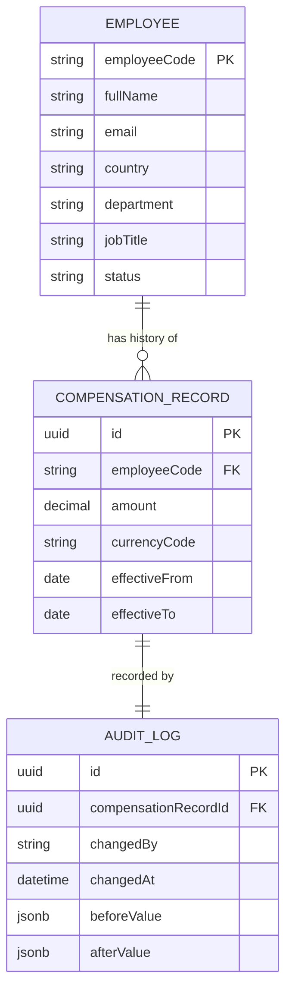
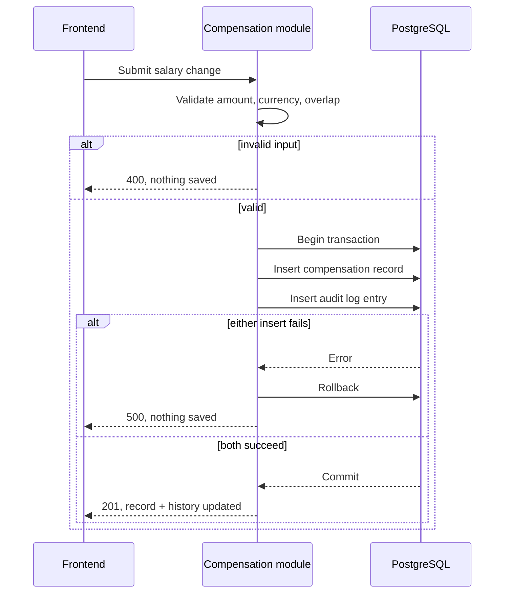

# Backend Architecture
## ACME Employee Compensation Management System

| | |
|---|---|
| **Status** | Draft. Architecture only — no code, no Prisma schema, no migrations yet. |
| **Source of truth** | [`requirements.md`](requirements.md) (committed, current) and [`feature-plan.md`](feature-plan.md) |
| **Stack (as already scaffolded)** | Backend: NestJS 12 + TypeScript + Prisma 7 (`@prisma/client`, `@prisma/adapter-pg`) + PostgreSQL via `pg`. Frontend: Next.js 16 (App Router) + TanStack Query + shadcn/ui + Tailwind, out of this document's scope except for the system context below. |
| **Scope note** | This document describes module boundaries, data entities and request flows conceptually. Per CLAUDE.md, the actual `schema.prisma`, migrations and business logic are written in `backend/` when implementation starts — not here. |

---

## 1. System context

The frontend never talks to PostgreSQL directly; the API is the only component with database access, and the only component that enforces who is allowed to see or change what.

<svg width="100%" viewBox="0 0 680 160" role="img">
<title>System context diagram</title>
<desc>Browser talks to the Next.js frontend, which calls the NestJS API over REST, which is the only component allowed to read or write PostgreSQL.</desc>
<defs><marker id="arrow1" viewBox="0 0 10 10" refX="8" refY="5" markerWidth="6" markerHeight="6" orient="auto-start-reverse"><path d="M2 1L8 5L2 9" fill="none" stroke="context-stroke" stroke-width="1.5"/></marker></defs>
<rect x="40" y="30" width="130" height="56" rx="8" fill="none" stroke="currentColor" stroke-width="0.5"/>
<text x="105" y="50" text-anchor="middle">Browser</text>
<text x="105" y="68" text-anchor="middle" font-size="12">HR Manager</text>
<rect x="190" y="30" width="130" height="56" rx="8" fill="none" stroke="currentColor" stroke-width="0.5"/>
<text x="255" y="50" text-anchor="middle">Next.js frontend</text>
<text x="255" y="68" text-anchor="middle" font-size="12">App Router, UI only</text>
<rect x="340" y="30" width="130" height="56" rx="8" fill="none" stroke="currentColor" stroke-width="0.5"/>
<text x="405" y="50" text-anchor="middle">NestJS API</text>
<text x="405" y="68" text-anchor="middle" font-size="12">Auth + business rules</text>
<rect x="490" y="30" width="130" height="56" rx="8" fill="none" stroke="currentColor" stroke-width="0.5"/>
<text x="555" y="50" text-anchor="middle">PostgreSQL</text>
<text x="555" y="68" text-anchor="middle" font-size="12">Via Prisma only</text>
<line x1="170" y1="58" x2="188" y2="58" stroke="currentColor" stroke-width="1" marker-end="url(#arrow1)"/>
<line x1="320" y1="58" x2="338" y2="58" stroke="currentColor" stroke-width="1" marker-end="url(#arrow1)"/>
<line x1="470" y1="58" x2="488" y2="58" stroke="currentColor" stroke-width="1" marker-end="url(#arrow1)"/>
</svg>

*(Shown above in chat as `system_context_diagram`.)*

---

## 2. Module breakdown

NestJS modules, following CLAUDE.md's backend guidelines (modules/controllers/providers, business logic in services, DTOs with validation pipes).

<svg width="100%" viewBox="0 0 680 460" role="img">
<title>Backend module diagram</title>
<desc>Five NestJS feature modules — Auth, Employees, Compensation, Reporting and Audit — each depend on one shared database module backed by Prisma.</desc>
<defs><marker id="arrow2" viewBox="0 0 10 10" refX="8" refY="5" markerWidth="6" markerHeight="6" orient="auto-start-reverse"><path d="M2 1L8 5L2 9" fill="none" stroke="context-stroke" stroke-width="1.5"/></marker></defs>
<rect x="30" y="20" width="610" height="380" rx="16" fill="none" stroke="currentColor" stroke-width="0.5"/>
<text x="50" y="44">NestJS API</text>
<rect x="60" y="70" width="190" height="44" rx="8" fill="none" stroke="currentColor" stroke-width="0.5"/>
<text x="155" y="88" text-anchor="middle">Auth</text>
<text x="155" y="104" text-anchor="middle" font-size="12">Sign-in &amp; sessions</text>
<rect x="60" y="128" width="190" height="44" rx="8" fill="none" stroke="currentColor" stroke-width="0.5"/>
<text x="155" y="146" text-anchor="middle">Employees</text>
<text x="155" y="162" text-anchor="middle" font-size="12">Directory &amp; profile</text>
<rect x="60" y="186" width="190" height="44" rx="8" fill="none" stroke="currentColor" stroke-width="0.5"/>
<text x="155" y="204" text-anchor="middle">Compensation</text>
<text x="155" y="220" text-anchor="middle" font-size="12">Revisions &amp; history</text>
<rect x="60" y="244" width="190" height="44" rx="8" fill="none" stroke="currentColor" stroke-width="0.5"/>
<text x="155" y="262" text-anchor="middle">Reporting</text>
<text x="155" y="278" text-anchor="middle" font-size="12">Per-country stats</text>
<rect x="60" y="302" width="190" height="44" rx="8" fill="none" stroke="currentColor" stroke-width="0.5"/>
<text x="155" y="320" text-anchor="middle">Audit</text>
<text x="155" y="336" text-anchor="middle" font-size="12">Who, when, what</text>
<rect x="440" y="158" width="170" height="100" rx="8" fill="none" stroke="currentColor" stroke-width="0.5"/>
<text x="525" y="198" text-anchor="middle">Database module</text>
<text x="525" y="216" text-anchor="middle" font-size="12">Via Prisma client</text>
<line x1="250" y1="92" x2="438" y2="185" stroke="currentColor" stroke-width="1" marker-end="url(#arrow2)"/>
<line x1="250" y1="150" x2="438" y2="195" stroke="currentColor" stroke-width="1" marker-end="url(#arrow2)"/>
<line x1="250" y1="208" x2="438" y2="208" stroke="currentColor" stroke-width="1" marker-end="url(#arrow2)"/>
<line x1="250" y1="266" x2="438" y2="221" stroke="currentColor" stroke-width="1" marker-end="url(#arrow2)"/>
<line x1="250" y1="324" x2="438" y2="231" stroke="currentColor" stroke-width="1" marker-end="url(#arrow2)"/>
</svg>

*(Shown above in chat as `backend_module_diagram`. The `Health` module is already scaffolded in `backend/src/modules/api/health` and needs no further design.)*

| Module | Responsibility | Depends on |
|---|---|---|
| `AuthModule` | Credential check, session/token issuance, the guard every other module's routes use | `PrismaModule` (to look up the HR Manager account) |
| `EmployeesModule` | Directory search/filter/sort/pagination; single-employee profile read; create/edit employee details | `PrismaModule`, protected by `AuthModule`'s guard |
| `CompensationModule` | Record a salary revision; read current compensation and history; owns the overlap-validation rule | `PrismaModule`, `AuthModule` guard |
| `ReportingModule` | Aggregated counts and per-currency statistics by country/department, for the dashboard | `PrismaModule`, `AuthModule` guard (read-only) |
| `AuditModule` | Written to by `CompensationModule` inside the same transaction; no independent write entry point of its own | `PrismaModule` |
| `PrismaModule` | Wraps the Prisma client as an injectable provider; the only module touching Postgres directly | — |
| `HealthModule` | Already scaffolded; unchanged | — |

`AuditModule` is modeled as a service used by `CompensationModule`, not a module with its own controller — `requirements.md` gives no requirement for standalone audit-log CRUD, only that compensation changes are attributed and recorded.

---

## 3. Conceptual data model

Entities and relationships only — field types, indexes and constraints are decided when the Prisma schema is written in `backend/prisma/schema.prisma`.

*(Shown above in chat as `conceptual_data_model`.)*

- **Employee** — one row per employee. `employeeCode` is the business-unique identifier `requirements.md` requires; how it's generated is an open gap (§6).
- **CompensationRecord** — append-only history. A new salary change does not overwrite a row; it closes the current record's `effectiveTo` and inserts a new one, so "current compensation" is simply the record with `effectiveTo IS NULL` (or the latest `effectiveFrom`, if backdating policy allows more than one open-ended pattern — flagged in §6). Amount is a decimal type and a separate ISO 4217 `currencyCode`, never mixed or converted.
- **AuditLog** — one row per compensation write, holding before/after values, who made the change and when, written in the same transaction as its `CompensationRecord`.
- **Country / Department / JobTitle** — `requirements.md` requires filtering by these but doesn't say whether they're free text or managed lists. Modeled as plain string fields on `Employee` for now, not separate reference tables, until that's decided (§6) — this avoids building reference-data management screens that may not be wanted.

---

## 4. Request flow: record a salary change

The highest-risk flow, because `requirements.md` explicitly requires the compensation write and its audit entry to succeed or fail together.

*(Shown above in chat as `record_salary_change_sequence`.)*

1. A DTO validates shape (amount is numeric and positive, currency is a valid ISO 4217 code) before any business logic runs.
2. The service checks the new effective period against the employee's existing compensation records for an overlap; an overlap is rejected before any write happens.
3. The compensation insert and the audit insert run inside one Prisma transaction (`prisma.$transaction`). If either fails, both roll back — this is the mechanism behind `requirements.md`'s "a failed audit write rolls back the salary change" success criterion.
4. The response reflects exactly what was committed; the frontend refetches (TanStack Query) rather than assuming optimistic state, since a rejection must be visibly reflected.

### Other representative flows (described, not diagrammed again)

- **Employee directory search/filter/sort/paginate:** a single `EmployeesModule` endpoint takes search/filter/sort/page parameters, builds one Prisma query (`where`/`orderBy`/`skip`/`take`), and returns a page plus a total count. All of this happens server-side — the client never receives the full employee set, which matters directly at the ~10,000-employee scale `requirements.md` specifies.
- **Dashboard/report aggregation:** `ReportingModule` groups by country, department and currency using Prisma's aggregation (`groupBy`) or a raw read query, computing count/min/max/average per group. Figures from different currencies are never combined into one number — each statistic is returned with its currency attached, matching `requirements.md`'s explicit rule.

---

## 5. Cross-cutting concerns

| Concern | Approach |
|---|---|
| **Authentication & authorization** | Enforced in the backend (NestJS guard), never only in the UI, per CLAUDE.md's security guidelines. Every module except `Health` sits behind the same guard. |
| **Validation** | DTOs with a validation pipe on every controller method; invalid input is rejected before it reaches a service. |
| **Transactions** | Used wherever a request writes more than one related row — compensation + audit (§4) is the primary case. |
| **Money handling** | Decimal types end-to-end (Prisma `Decimal`, not JavaScript `number`/float) for amounts, per CLAUDE.md's database guidelines and `requirements.md`'s explicit rule against floating-point money. |
| **Error handling & responses** | Consistent API response shape and appropriate HTTP status codes (400 for validation, 401/403 for auth, 404 for missing records, 500 for unexpected failures) across all modules. |
| **Testing** | Jest unit tests for service-level business logic (validation, overlap detection, aggregation math); Supertest integration tests per endpoint covering success, validation failure and authorization failure, per CLAUDE.md's testing guidelines. |

---

## 6. Explicitly flagged gaps

These are not resolved here — they're accommodated so the schema doesn't need a rewrite once answered, per `feature-plan.md` §3:

- **Salary basis (annual/monthly/hourly, base/total)** — `CompensationRecord` stores one `amount` + `currencyCode` + effective dates, with no assumption baked in about what period the amount represents. The UI label and any derived figure depend on this being answered before `CompensationModule`'s validation and display logic are finished.
- **Employee-code generation** — whether `employeeCode` is supplied by HR or generated by the system is undecided; the model only requires it to be unique. This must be settled before the `Employee` model is finalized, since it affects whether the API accepts it on create or generates it server-side.
- **Backdating policy** — the overlap-validation rule in §4 needs an explicit answer on whether past-dated and future-dated changes are both allowed, and how an "open-ended" record is chosen when more than one exists.
- **Role model** — `requirements.md` names a single HR Manager persona. The `AuthModule` guard is written as one central permission check rather than scattered per-endpoint logic specifically so a second role could be introduced later without reworking every module — but no second role is assumed or built now.
- **Country/Department/JobTitle as managed lists vs. free text** — modeled as plain fields for now (§3); if these need to become managed reference data later, that's a schema addition, not a rewrite.

Non-goals, matching `requirements.md`'s "Deliberately out of scope": CSV/Excel import, automatic currency conversion or consolidated global totals, approval workflows, multiple HR roles, employee self-service, payroll execution.
